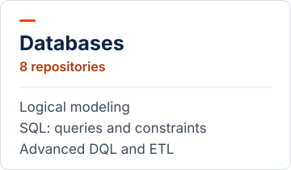
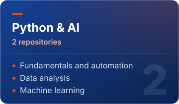
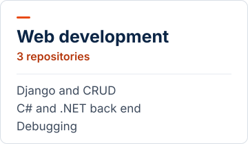
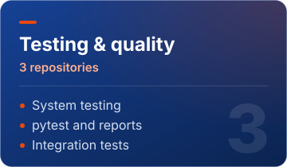
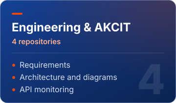
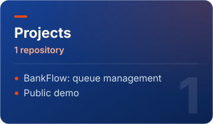

<picture><source media="(prefers-color-scheme: dark)" srcset="https://raw.githubusercontent.com/MatheusBenvindo/MatheusBenvindo/main/assets/hero-en-dark.svg?v=20261123" /></picture>

  <a href="https://matheusbenvindo.github.io/MBR-Portfolio/">Portfolio</a> &nbsp;·&nbsp;
  <a href="https://www.linkedin.com/in/matheus-b-ribeiro">LinkedIn</a> &nbsp;·&nbsp;
  <a href="https://github.com/MatheusBenvindo/MatheusBenvindo/blob/main/CURSOS.md">Course materials</a> &nbsp;·&nbsp;
  <a href="https://github.com/MatheusBenvindo/MatheusBenvindo/blob/main/README.md">Português</a>

### About

I work with data and teach technology. I am currently a systems development and databases instructor at SENAI.

Before that, as an IT analyst in data, governance and security, I automated GRC routines with Python and SQL and built Power BI dashboards to track access and audits.

MBA in Data Analytics, postgraduate degree in IT Audit and Governance, and a Computer Science degree in progress.

### Tools

  
  
  
  

| Area | Day to day |
|---|---|
| Data & BI | Power BI (DAX, Power Query), SQL, Python with Pandas and scikit-learn, Jupyter |
| Databases | Relational modeling, MySQL, SQLite |
| Automation | Python scripts, Power Automate |
| Development | Django, JavaScript, C# and .NET, HTML, CSS, Tailwind, Bootstrap, Git |

### Featured projects

| Project | What it is | Stack |
|---|---|---|
| [Flight delay prediction](https://github.com/MatheusBenvindo/flight-delay-prediction-ml) | Classification model with feature engineering, evaluated on accuracy and F1. | Python, Pandas, XGBoost, scikit-learn |
| [Advanced DQL and ETL](https://github.com/MatheusBenvindo/DQL-AVANCADO-DBAS) | Interactive lab on JOINs, CASE WHEN, data investigation and ETL pipelines. | SQL |
| [Python: automation and logic](https://github.com/MatheusBenvindo/python-fundamentals-automation) | Exercises and projects on files, OOP, ETL and business rules. | Python, Django |
| [BankFlow](https://github.com/MatheusBenvindo/BankFlow-Demo) | Demo of a queue and customer service system with real-time updates. | C#, .NET, SignalR, SQLite |

### GitHub activity

  <picture><source media="(prefers-color-scheme: dark)" srcset="https://raw.githubusercontent.com/MatheusBenvindo/MatheusBenvindo/main/assets/langs-dark.svg?v=20261123" /></picture>
  <picture><source media="(prefers-color-scheme: dark)" srcset="https://raw.githubusercontent.com/MatheusBenvindo/MatheusBenvindo/main/assets/stats-dark.svg?v=20261123" /></picture>

### Materials by subject

<table>
  <tr>
    <td width="33%"><a href="https://github.com/MatheusBenvindo/MatheusBenvindo/blob/main/CURSOS.md#banco-de-dados"><picture><source media="(prefers-color-scheme: dark)" srcset="https://raw.githubusercontent.com/MatheusBenvindo/MatheusBenvindo/main/assets/tile-en-banco-de-dados-dark.svg?v=20261123" /></picture></a></td>
    <td width="33%"><a href="https://github.com/MatheusBenvindo/MatheusBenvindo/blob/main/CURSOS.md#python-e-ia"><picture><source media="(prefers-color-scheme: dark)" srcset="https://raw.githubusercontent.com/MatheusBenvindo/MatheusBenvindo/main/assets/tile-en-python-e-ia-dark.svg?v=20261123" /></picture></a></td>
    <td width="33%"><a href="https://github.com/MatheusBenvindo/MatheusBenvindo/blob/main/CURSOS.md#desenvolvimento-web"><picture><source media="(prefers-color-scheme: dark)" srcset="https://raw.githubusercontent.com/MatheusBenvindo/MatheusBenvindo/main/assets/tile-en-desenvolvimento-web-dark.svg?v=20261123" /></picture></a></td>
  </tr>
  <tr>
    <td width="33%"><a href="https://github.com/MatheusBenvindo/MatheusBenvindo/blob/main/CURSOS.md#testes-e-qualidade"><picture><source media="(prefers-color-scheme: dark)" srcset="https://raw.githubusercontent.com/MatheusBenvindo/MatheusBenvindo/main/assets/tile-en-testes-e-qualidade-dark.svg?v=20261123" /></picture></a></td>
    <td width="33%"><a href="https://github.com/MatheusBenvindo/MatheusBenvindo/blob/main/CURSOS.md#engenharia-e-akcit"><picture><source media="(prefers-color-scheme: dark)" srcset="https://raw.githubusercontent.com/MatheusBenvindo/MatheusBenvindo/main/assets/tile-en-engenharia-e-akcit-dark.svg?v=20261123" /></picture></a></td>
    <td width="33%"><a href="https://github.com/MatheusBenvindo/MatheusBenvindo/blob/main/CURSOS.md#projetos"><picture><source media="(prefers-color-scheme: dark)" srcset="https://raw.githubusercontent.com/MatheusBenvindo/MatheusBenvindo/main/assets/tile-en-projetos-dark.svg?v=20261123" /></picture></a></td>
  </tr>
</table>
