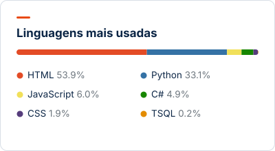
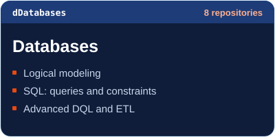
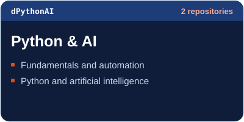
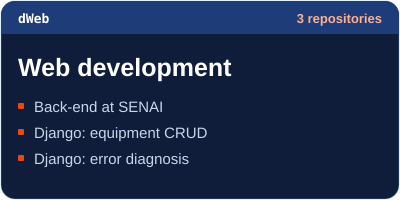
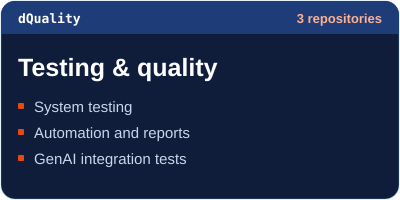
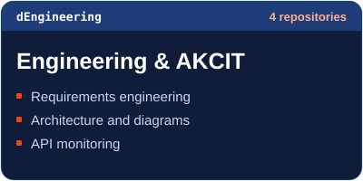
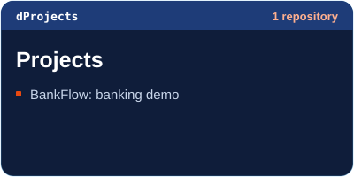

<picture>
  <source media="(prefers-color-scheme: dark)" srcset="https://raw.githubusercontent.com/MatheusBenvindo/MatheusBenvindo/main/assets/hero-en-dark.svg" />
  
</picture>

  
  
  

<h3>This week in class</h3>

The SENAI-DF Power BI class became a data agency: five fictional clients, messy real-world datasets and a final pitch to the decision maker. Briefs, datasets and activities live on the <a href="https://matheusbenvindo.github.io/agencia-dados-senai/">Data Agency site</a>.

<h3>GitHub activity</h3>

  <picture>
    <source media="(prefers-color-scheme: dark)" srcset="https://raw.githubusercontent.com/MatheusBenvindo/MatheusBenvindo/main/assets/langs-dark.svg" />
    
  </picture>
  <picture>
    <source media="(prefers-color-scheme: dark)" srcset="https://raw.githubusercontent.com/MatheusBenvindo/MatheusBenvindo/main/assets/stats-dark.svg" />
    
  </picture>

<h3>Everyday tools</h3>

  
  
  

<h3>Materials by subject</h3>

<table>
  <tr>
    <td width="33%"></td>
    <td width="33%"></td>
    <td width="33%"></td>
  </tr>
  <tr>
    <td width="33%"></td>
    <td width="33%"></td>
    <td width="33%"></td>
  </tr>
</table>
