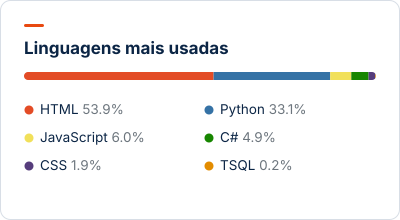
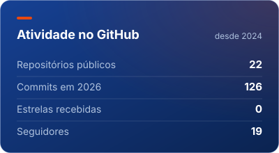
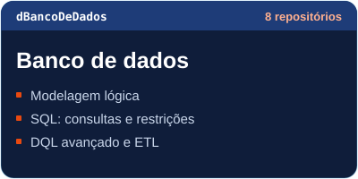
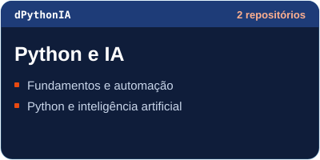
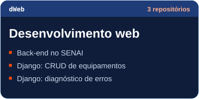

<picture>
  <source media="(prefers-color-scheme: dark)" srcset="https://raw.githubusercontent.com/MatheusBenvindo/MatheusBenvindo/main/assets/hero-pt-dark.svg" />
  
</picture>

  
  
  

<h3>Atividade no GitHub</h3>

  <picture>
    <source media="(prefers-color-scheme: dark)" srcset="https://raw.githubusercontent.com/MatheusBenvindo/MatheusBenvindo/main/assets/langs-dark.svg" />
    
  </picture>
  <picture>
    <source media="(prefers-color-scheme: dark)" srcset="https://raw.githubusercontent.com/MatheusBenvindo/MatheusBenvindo/main/assets/stats-dark.svg" />
    
  </picture>

<h3>Ferramentas do dia a dia</h3>

  
  
  

<h3>Materiais por assunto</h3>

<table>
  <tr>
    <td width="33%"></td>
    <td width="33%"></td>
    <td width="33%"></td>
  </tr>
  <tr>
    <td width="33%"></td>
    <td width="33%"></td>
    <td width="33%"></td>
  </tr>
</table>
