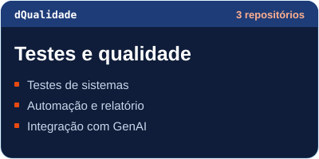
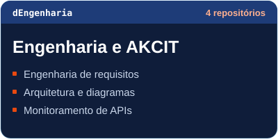
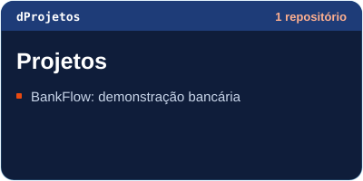

<picture>
  <source media="(prefers-color-scheme: dark)" srcset="https://raw.githubusercontent.com/MatheusBenvindo/MatheusBenvindo/main/assets/hero-pt-dark.svg" />
  
</picture>

  
  
  

<h3>Nesta semana na sala de aula</h3>

A turma de Power BI do SENAI-DF virou uma agência de dados: cinco clientes fictícios, bases com problemas reais e uma apresentação final para quem decide. Os briefings, as bases e as atividades estão no site da <a href="https://matheusbenvindo.github.io/agencia-dados-senai/">Agência de Dados</a>.

<h3>Atividade no GitHub</h3>

  <picture>
    <source media="(prefers-color-scheme: dark)" srcset="https://github-readme-stats-eight-theta.vercel.app/api/top-langs/?username=MatheusBenvindo&amp;theme=transparent&amp;locale=pt-br&amp;hide_border=true&amp;title_color=5BB8F0&amp;text_color=C9D6EA&amp;icon_color=E84910&amp;langs_count=7&amp;layout=compact&amp;hide=jupyter%20notebook" />
    
  </picture>
  <picture>
    <source media="(prefers-color-scheme: dark)" srcset="https://github-readme-stats-eight-theta.vercel.app/api?username=MatheusBenvindo&amp;theme=transparent&amp;locale=pt-br&amp;hide_border=true&amp;title_color=5BB8F0&amp;text_color=C9D6EA&amp;icon_color=E84910&amp;show_icons=true" />
    
  </picture>

<h3>Ferramentas do dia a dia</h3>

  
  
  

<h3>Materiais por assunto</h3>

<table>
  <tr>
    <td width="33%"></td>
    <td width="33%"></td>
    <td width="33%"></td>
  </tr>
  <tr>
    <td width="33%"></td>
    <td width="33%"></td>
    <td width="33%"></td>
  </tr>
</table>
