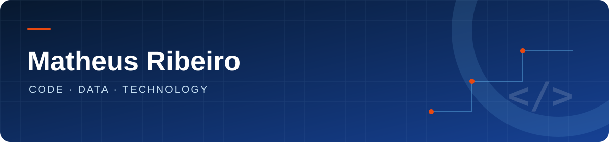

  

 
 

<h2 align="center">Tecnologias</h2>

  

<h2 align="center">Estatísticas</h2>

  
  

<h2 align="center">Explore os materiais</h2>

<table align="center">
  <tr><td align="center" width="50%"><a href="https://github.com/MatheusBenvindo/MatheusBenvindo/blob/main/CURSOS.md#banco-de-dados"><strong>Banco de dados</strong></a> SQL · Modelagem · ETL</td><td align="center" width="50%"><a href="https://github.com/MatheusBenvindo/MatheusBenvindo/blob/main/CURSOS.md#python-e-ia"><strong>Python e IA</strong></a> Python · Machine Learning · OpenCV</td></tr>
  <tr><td align="center" width="50%"><a href="https://github.com/MatheusBenvindo/MatheusBenvindo/blob/main/CURSOS.md#desenvolvimento-web"><strong>Desenvolvimento web</strong></a> C# · .NET · Django</td><td align="center" width="50%"><a href="https://github.com/MatheusBenvindo/MatheusBenvindo/blob/main/CURSOS.md#testes-e-qualidade"><strong>Testes e qualidade</strong></a> Testes · Automação · Integração</td></tr>
  <tr><td align="center" width="50%"><a href="https://github.com/MatheusBenvindo/MatheusBenvindo/blob/main/CURSOS.md#engenharia-e-akcit"><strong>Engenharia e AKCIT</strong></a> Requisitos · Arquitetura · APIs</td><td align="center" width="50%"><a href="https://github.com/MatheusBenvindo/MatheusBenvindo/blob/main/CURSOS.md#projetos"><strong>Projetos</strong></a> BankFlow · Demonstrações</td></tr>
</table>

