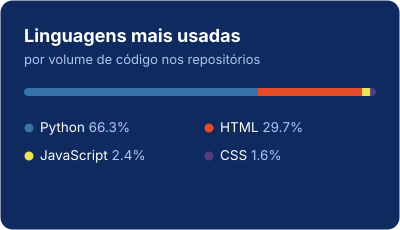
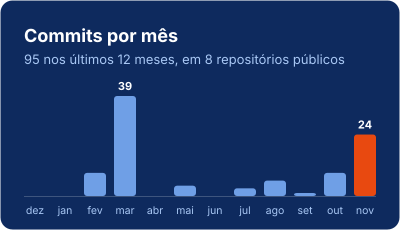
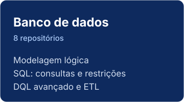
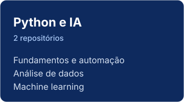
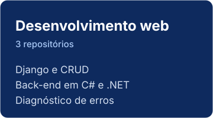
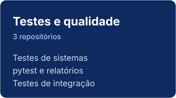
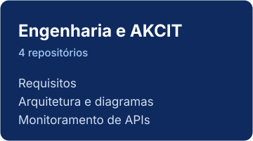
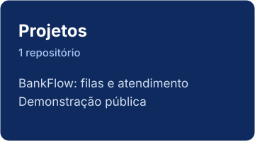

<picture><source media="(prefers-color-scheme: dark)" srcset="https://raw.githubusercontent.com/MatheusBenvindo/MatheusBenvindo/main/assets/hero-pt-dark-96697e94.svg" /></picture>

  <a href="https://matheusbenvindo.github.io/MBR-Portfolio/">Portfólio</a> &nbsp;&nbsp;&nbsp;
  <a href="https://www.linkedin.com/in/matheus-b-ribeiro">LinkedIn</a> &nbsp;&nbsp;&nbsp;
  <a href="https://github.com/MatheusBenvindo/MatheusBenvindo/blob/main/CURSOS.md">Materiais de curso</a> &nbsp;&nbsp;&nbsp;
  <a href="https://github.com/MatheusBenvindo/MatheusBenvindo/blob/main/README.en.md">English</a>

### Sobre

Trabalho com dados e ensino tecnologia. Hoje sou instrutor de desenvolvimento de sistemas e banco de dados no SENAI.

Antes, como analista de TI na área de dados, governança e segurança, automatizei rotinas de GRC com Python e SQL e montei painéis em Power BI para acompanhar acessos e auditoria.

MBA em Análise de Dados, pós-graduação em Auditoria e Governança de TI e graduação em Ciência da Computação em andamento.

### Ferramentas

  
  
  
  

| Área | No dia a dia |
|---|---|
| Dados e BI | Power BI (DAX, Power Query), SQL, Python com Pandas e scikit-learn, Jupyter |
| Bancos | Modelagem relacional, MySQL, SQLite |
| Automação | Scripts em Python, Power Automate |
| Desenvolvimento | Django, JavaScript, C# e .NET, HTML, CSS, Bootstrap, Git |

### Projetos em destaque

| Projeto | O que é | Stack |
|---|---|---|
| [Previsão de atrasos aéreos](https://github.com/MatheusBenvindo/flight-delay-prediction-ml) | Modelo de classificação com engenharia de atributos, avaliado por acurácia e F1. | Python, Pandas, XGBoost, scikit-learn |
| [DQL avançado e ETL](https://matheusbenvindo.github.io/DQL-AVANCADO-DBAS/) | Laboratório interativo de JOINs, CASE WHEN, investigação de dados e pipelines ETL. | SQL |
| [Python: automação e lógica](https://github.com/MatheusBenvindo/python-fundamentals-automation) | Exercícios e projetos com arquivos, orientação a objetos, ETL e regras de negócio. | Python, Django |
| [BankFlow](https://github.com/MatheusBenvindo/BankFlow-Demo) | Demonstração de um sistema de filas e atendimento com atualização em tempo real. | C#, .NET, SignalR, SQLite |

### Atividade no GitHub

  <picture><source media="(prefers-color-scheme: dark)" srcset="https://raw.githubusercontent.com/MatheusBenvindo/MatheusBenvindo/main/assets/langs-dark-c56fd5ab.svg" /></picture>
  <picture><source media="(prefers-color-scheme: dark)" srcset="https://raw.githubusercontent.com/MatheusBenvindo/MatheusBenvindo/main/assets/stats-dark-a75598ad.svg" /></picture>

### Materiais por assunto

<table>
  <tr>
    <td width="33%"><a href="https://github.com/MatheusBenvindo/MatheusBenvindo/blob/main/CURSOS.md#banco-de-dados"><picture><source media="(prefers-color-scheme: dark)" srcset="https://raw.githubusercontent.com/MatheusBenvindo/MatheusBenvindo/main/assets/tile-pt-banco-de-dados-dark-187f82cb.svg" /></picture></a></td>
    <td width="33%"><a href="https://github.com/MatheusBenvindo/MatheusBenvindo/blob/main/CURSOS.md#python-e-ia"><picture><source media="(prefers-color-scheme: dark)" srcset="https://raw.githubusercontent.com/MatheusBenvindo/MatheusBenvindo/main/assets/tile-pt-python-e-ia-dark-c081d9af.svg" /></picture></a></td>
    <td width="33%"><a href="https://github.com/MatheusBenvindo/MatheusBenvindo/blob/main/CURSOS.md#desenvolvimento-web"><picture><source media="(prefers-color-scheme: dark)" srcset="https://raw.githubusercontent.com/MatheusBenvindo/MatheusBenvindo/main/assets/tile-pt-desenvolvimento-web-dark-57f59472.svg" /></picture></a></td>
  </tr>
  <tr>
    <td width="33%"><a href="https://github.com/MatheusBenvindo/MatheusBenvindo/blob/main/CURSOS.md#testes-e-qualidade"><picture><source media="(prefers-color-scheme: dark)" srcset="https://raw.githubusercontent.com/MatheusBenvindo/MatheusBenvindo/main/assets/tile-pt-testes-e-qualidade-dark-4ada78f7.svg" /></picture></a></td>
    <td width="33%"><a href="https://github.com/MatheusBenvindo/MatheusBenvindo/blob/main/CURSOS.md#engenharia-e-akcit"><picture><source media="(prefers-color-scheme: dark)" srcset="https://raw.githubusercontent.com/MatheusBenvindo/MatheusBenvindo/main/assets/tile-pt-engenharia-e-akcit-dark-ea216597.svg" /></picture></a></td>
    <td width="33%"><a href="https://github.com/MatheusBenvindo/MatheusBenvindo/blob/main/CURSOS.md#projetos"><picture><source media="(prefers-color-scheme: dark)" srcset="https://raw.githubusercontent.com/MatheusBenvindo/MatheusBenvindo/main/assets/tile-pt-projetos-dark-d1cef453.svg" /></picture></a></td>
  </tr>
</table>
